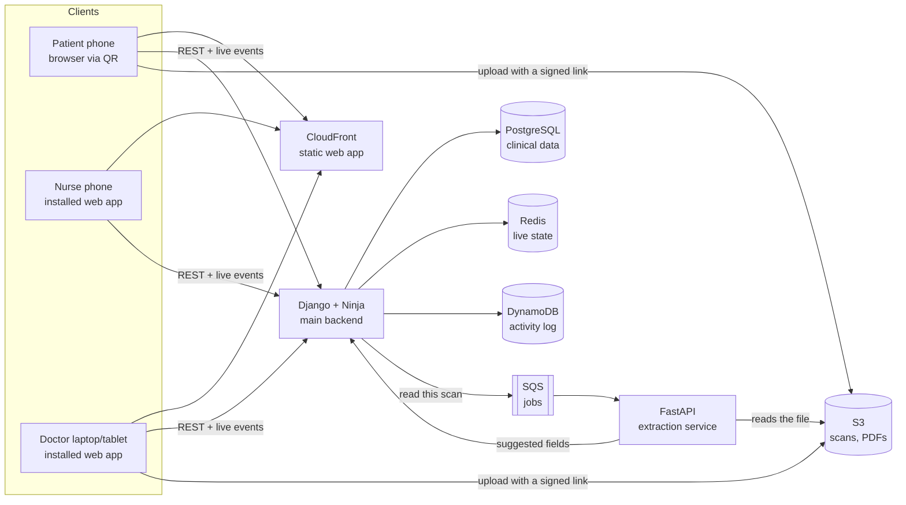

# Architecture

How the parts of OPDly fit together. The choices and the reasons behind them are in [D-0006](decisions/0006-tech-stack.md). The data model principles are in [D-0005](decisions/0005-multi-clinic-data-model.md).

## Components
- **Web app:** React + TypeScript, served as static files and installable as an app. One codebase covers all three roles. Screens are shown according to the user's role.
- **Main backend (Django + Ninja):** the REST API, login and roles, the admin panel for back-office lists, prescription PDFs (WeasyPrint), and live queue events (server-sent events).
- **Extraction service (FastAPI):** takes jobs from SQS, reads the file from S3, runs the configured provider (a local model or an external service), and sends suggested fields back to the main backend. Suggestions stay unverified until the doctor confirms them.
- **PostgreSQL:** all patient and clinic data, including clinic-defined fields (JSON columns). Every row carries a clinic ID.
- **Redis:** queue state for live updates, rate limits on the public QR form, caching. Nothing in it is the only copy of anything.
- **DynamoDB:** the append-only activity log. The backend can add entries but cannot change or delete them.

## Main flows
1. **Joining the queue:** the patient scans the day's QR code and fills in the form. The backend checks the day's code, the opening hours and the rate limit, then creates a token in PostgreSQL and pushes a live update through Redis. Staff see possible earlier records and confirm the match ([D-0002](decisions/0002-patient-matching.md)).
2. **The visit:**
   - The doctor picks the next patient. Past records load.
   - Orders are added, with doses filled in by the clinic's rules.
   - The cost is calculated, and the doctor can lock it.
   - The visit is handed off to the nurse task list or straight to the patient.
   - Each step is recorded in the activity log.
3. **Scan import:**
   - The scan uploads to S3 through a signed link.
   - The backend queues a job, and the extraction service returns suggested fields.
   - The doctor confirms or edits each field. The scan stays attached and marked external.
4. **Prescription output:** the backend renders an A4 PDF to print or download.

## Environments
- **Local:** docker-compose runs PostgreSQL, Redis, the backend, the extraction service and LocalStack (S3, SQS, DynamoDB).
- **CI:** GitHub Actions runs linters, type checks, pytest against PostgreSQL, and Playwright, then builds the images.
- **Cloud:** AWS Mumbai (ap-south-1), defined in Terraform. The hosting shape is decided at the first deployment ([roadmap](roadmap.md)).
